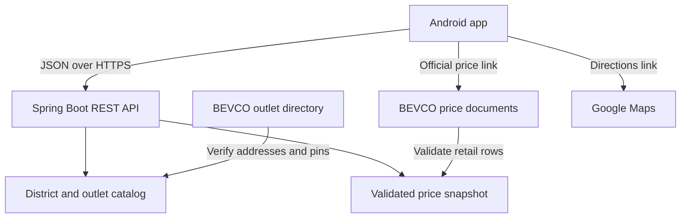
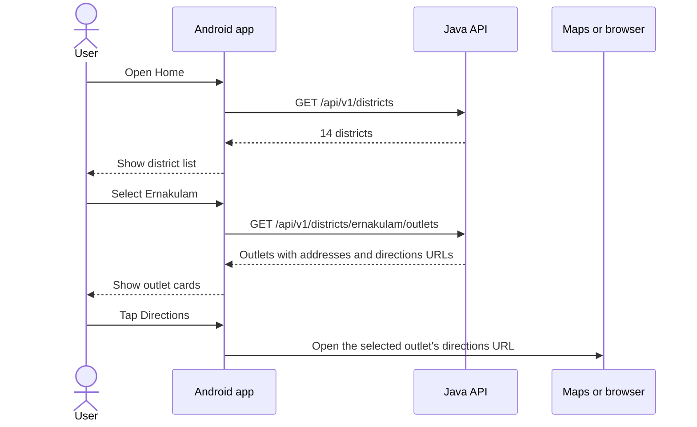
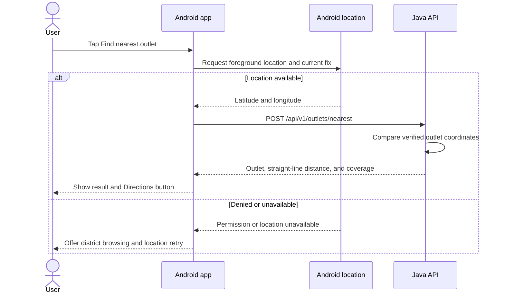
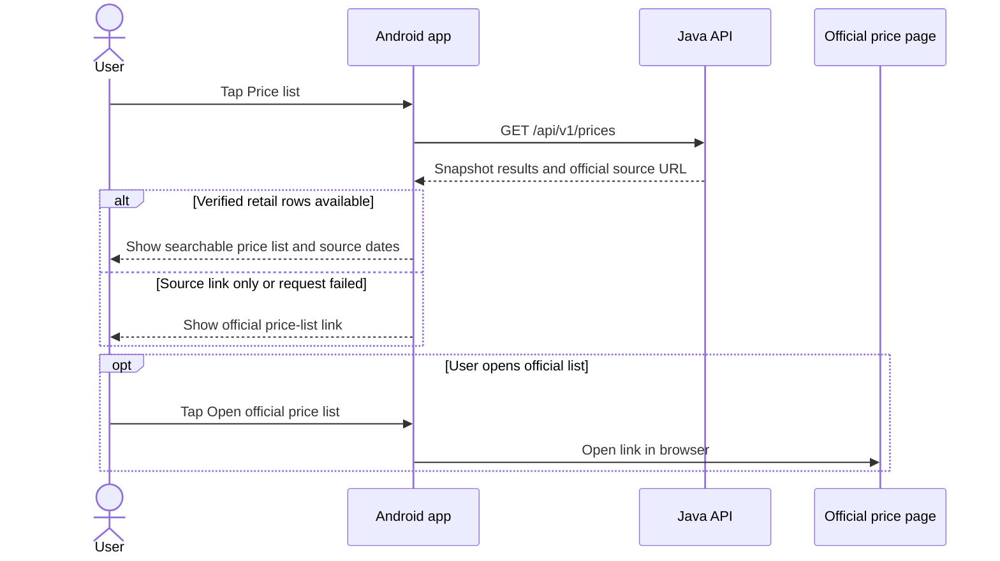

# Architecture and request flows

## System design

**Day 1 implementation:** a Java 21 Spring Boot app is built with Maven. Spring MVC routes `GET /api/v1/districts` to `DistrictController`. `DistrictService` loads the bundled district JSON at startup. The first API needs no external service or database at runtime.

**Target:** one Java backend serves catalog data and computes straight-line distance. The Android app handles screens, location consent, and external links. Maintain outlet and price snapshots separately so a BEVCO website delay does not slow ordinary API requests. Start with versioned local snapshots. Evaluate a database when updates or search requirements justify one.

**Data sources:** Kerala’s Civil Supplies department publishes the district list. BEVCO’s FL-1 directory is the source for outlet names and addresses. Confirm map pins separately if the directory entry only gives an address. Use the BEVCO Price List and Documents/Reports pages to identify the current price documents. The app displays source and effective date where available.

[Kerala districts](https://epos.kerala.gov.in/) · [BEVCO outlet directory](https://bevco.in/shop-locations/) · [BEVCO price list](https://bevco.in/price-list-2/) · [BEVCO Documents/Reports](https://bevco.in/documents-reports/)

## Browse districts, select an outlet, and open directions

## Find the nearest outlet

Coordinates are used for the lookup and excluded from application logs and storage. Show the result as an estimate when location is approximate. If only part of the catalog has verified pins, label the result “Nearest verified outlet.” Directions come from Google Maps. The API distance is straight-line distance.

[Android location permissions](https://developer.android.com/develop/sensors-and-location/location/permissions/runtime) · [Google Maps URLs](https://developers.google.com/maps/documentation/urls/get-started)

## View prices

