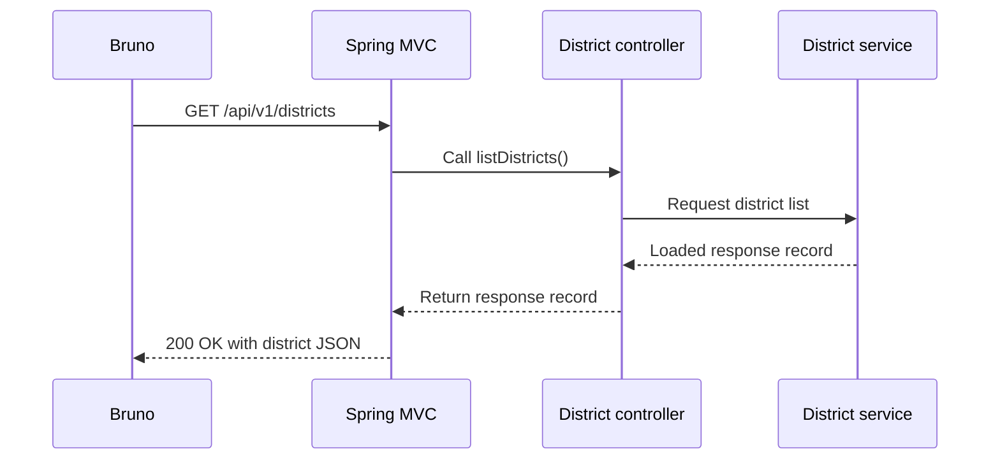

# Day 1 · District API with Spring Boot

The Android home screen needs a list of districts. On Day 1, `GET /api/v1/districts` returns that list. The app will display the district name and pass the ID to the Day 2 outlet endpoint.

## Follow the code in IntelliJ

1. **`pom.xml`** sets Java 21 and inherits dependency versions from the Spring Boot parent. `spring-boot-starter-webmvc` adds Spring MVC, the embedded web server, and JSON support. The test starter provides MockMvc and JUnit. The Maven plugin runs the app and packages an executable JAR.
2. **`KeralaOutletGuideApplication`** starts Spring Boot. `@SpringBootApplication` enables configuration and scans `com.keralaoutletguide.api` and its subpackages for components. During startup, Spring creates the service and injects it through the controller's constructor.
3. **`DistrictService`** opens `districts.json` from the classpath. Spring injects its configured Jackson `JsonMapper`. `readValue()` turns the JSON into a `DistrictsResponse` containing 14 `District` records. The stream closes at the end of the `try` block. The response record makes a read-only copy of the list so each request can safely share it. The file determines the order.
4. **`DistrictController`** maps `GET /api/v1/districts` to `listDistricts()` with `@GetMapping`. The method asks the service for the list and returns it. With `@RestController`, Spring writes the return value to the response body as JSON.
5. **`ApiExceptionHandler`** turns missing route and unsupported method errors into a JSON object with `code` and `message`. On `405` it keeps Spring's `Allow` header, which tells the caller which method to use. `application.properties` disables static resource mappings for this API project, so an unknown path produces a missing route error.

## Trace one request

The resource is read during startup. Follow the service constructor to see JSON become Java records, then set a breakpoint in `DistrictController.listDistricts()` to see a Bruno request reach the handler.

| Request | Expected result |
| --- | --- |
| `GET /api/v1/districts` | `200` with all 14 districts |
| `GET /api/v1/districts/` | `404` with `code: NOT_FOUND` |
| `POST /api/v1/districts` | `405` with `code: METHOD_NOT_ALLOWED` and `Allow: GET` |

The MockMvc tests exercise the same requests. Run them with `mvn test` from `backend/`. For a short exercise, set a breakpoint on the controller, send the GET request, and step into the service. Inspect the `id` and `name` of the Ernakulam record in the debugger.
