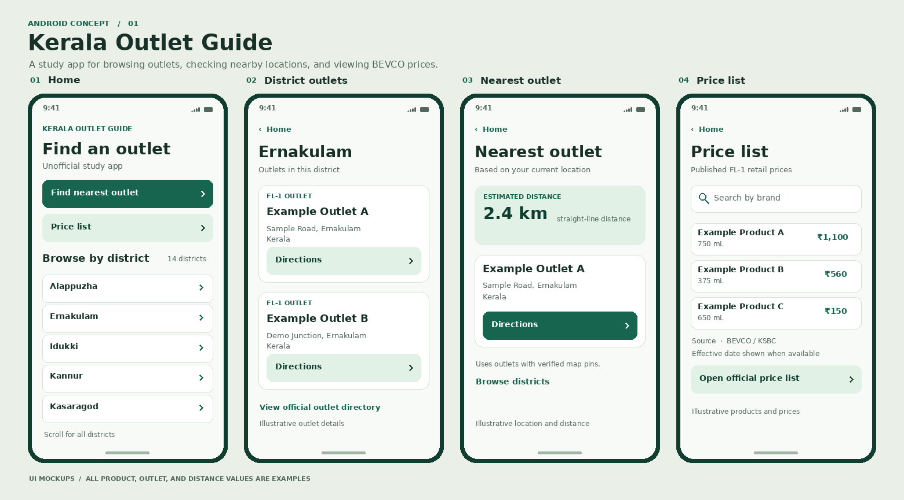

# Android UI and UX

The mockups use fictional outlet details and sample prices to show layout. Build the screens in native Android using Java, XML, and a scrollable list. The study app name is **Kerala Outlet Guide**.

| Screen | Content | Interactions and states |
| --- | --- | --- |
| Home | Find nearest outlet, Price list, then all 14 districts in alphabetical order. | Load districts on entry. Show Retry if the API is unavailable. Keep the feature buttons visible while districts load. Location permission is requested when the user taps Find nearest outlet. |
| District outlets | Selected district name, outlet names and full addresses, and Directions on each card. | Back returns to the prior scroll position. Open Maps with the outlet as the destination. If there are no rows, show a message and offer the official outlet directory. |
| Nearest outlet | Outlet name, address, straight-line distance, and Directions. | Show a loading state while getting a location. Accept approximate location and label the result as an estimate. When permission is denied or location is unavailable, offer Browse districts. Distinguish a network failure from missing location data. |
| Price list | Search, brand and bottle size, FL-1 retail price, source dates, and the official price-list link. | When only the source link is available, show it immediately and omit the search field. Show “No matching items” for a search with zero results. If the API fails, offer Retry and the bundled official link. |

Use a minimum 48 dp touch target, support larger system text, and allow addresses to wrap. Use text labels alongside status icons. Keep official links on the relevant screen so users can confirm data at its source.
